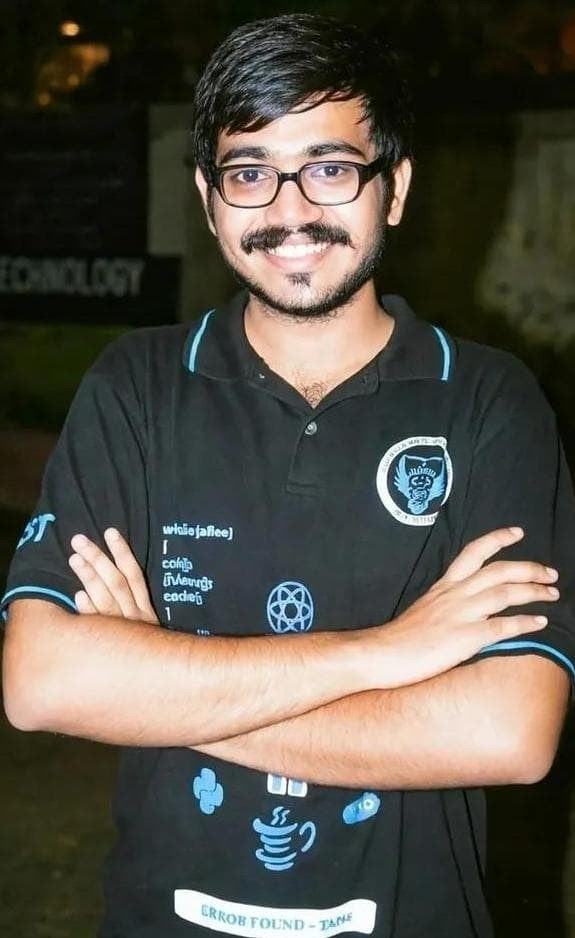

  

 

# 👋 Hi, I'm Parthib Ghosh

### 🔬 Security Researcher | 🛡️ Cyber-Physical Systems & Forensics | ⚛️ Materials-Aware Reliability

<b>Founder of XROS Labs • Creator of RoboIDS • CipherAI • Bhorosha</b>

  
  
  

---

## 👨‍💻 About Me

- 🔬 **Founder & Lead Researcher** at <b>XROS Labs</b>, exploring the intersection of Cyber-Physical Security, Digital Forensics, and Materials-Aware Reliability.
- 🎓 Transitioned from a Diploma in **Computer Science & Technology** (APCRP ’26) into a B.Tech in **Ceramic Technology** (GCECT ’29) to bridge software systems with physical-layer hardware reliability (**BITS & ATOMS**).
- 🔭 Currently building **Bhorosha**: an AI-powered multilingual cyber-safety and complaint-assistance platform.
- 🌱 Exploring **ROS2 Middleware, Formal Methods, Discrete Mathematics, Functional Ceramics, and Sensor Reliability**.
- 💬 Ask me about **Cybersecurity, ROS2, Digital Forensics, Python, FastAPI, React & Machine Learning**.

 

  
  
  
  

---

## 🔬 Research Intersections (BITS & ATOMS)

| 💻 **BITS (Software & Intelligence)** | ⚛️ **ATOMS (Materials & Hardware Reliability)** |
| :--- | :--- |
| • Network Intrusion Detection Systems (NIDS) • Digital Forensics & Incident Response (DFIR) • Secure ROS2 Robotics & Middleware • Multi-Agent AI Workflows | • Functional Ceramic & Sensor Materials • Materials Reliability & Degradation Analysis • Hardware-Software Interaction in CPS • Stabilized Computational Modeling |

---

## 🚀 Featured Projects & Preprints

| Project / Work | Tech Stack & Description | Links |
| :--- | :--- | :--- |
| 🛡️ **Bhorosha** | Multilingual cyber-safety platform analyzing incident descriptions. | Python, FastAPI, NLP |
| 🤖 **RoboIDS** | Dual-layer NIDS for ROS2 environments (*F1: 0.973, ROC-AUC: 0.998*). | ROS2, Python, Scikit-Learn |
| 🔍 **CipherAI** | Multi-agent AI-assisted forensic analysis framework for IOC extraction. | Python, PyShark, ReportLab |
| 📄 **Zenodo Preprints** | Independent research on the *Adaptive Balancing Scaling Model (ABSM)*. | [View Zenodo Publications](https://zenodo.org) |

---

## 🛠 Languages & Tools

  

  
  
  

---

## 📊 GitHub Analytics & Contributions

  

  
  
  
  
  

